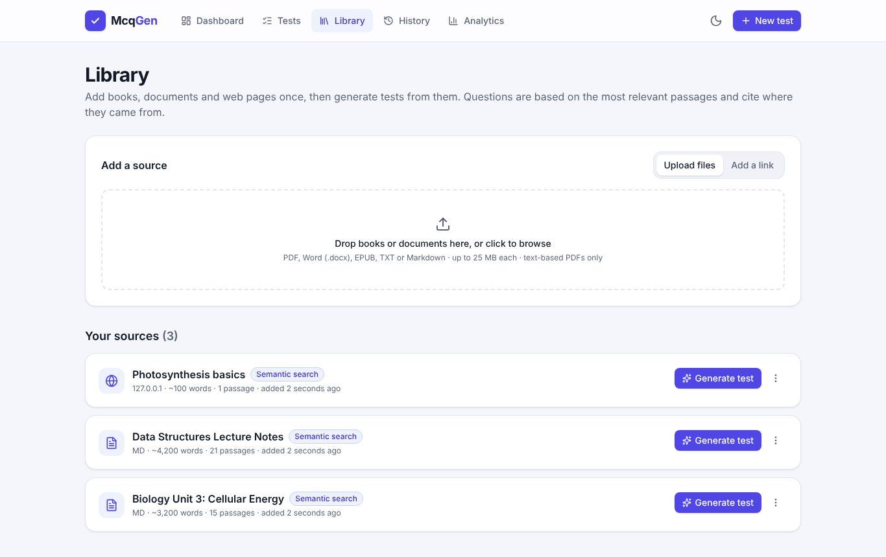
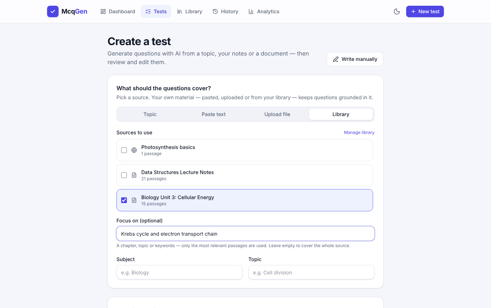
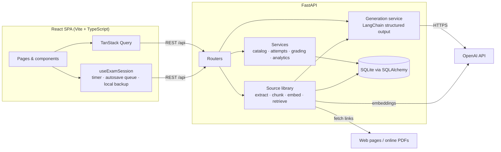

# McqGen — AI MCQ Exam Platform

Generate multiple-choice tests with AI from a topic, your notes, or a whole book in your **source library** (RAG with citations), review and edit every question, then take timed exams with a real exam interface and track your performance over time.


McqGen started as a small LangChain + Streamlit script that turned a document into a table of MCQs. It has grown into a full-stack exam platform: a **FastAPI** backend with **SQLite** persistence and a **React + TypeScript** frontend, covering the whole exam lifecycle: create → review → take → grade → analyse.

---

## Features

**Source library (RAG)**
- Add **books and documents** (PDF, Word `.docx`, EPUB, TXT, Markdown — up to 25 MB) or **web links** (articles or online PDFs) once, and reuse them for every test.
- Each source is extracted, split into page-aware passages and embedded with OpenAI `text-embedding-3-small`, stored in SQLite. Without an API key it still works with keyword search.
- **Focused generation**: type a chapter, topic or keywords and only the most relevant passages are retrieved (hybrid BM25 + vector search, fused with reciprocal-rank fusion and diversified with MMR). Leave it empty to sample passages **across the whole book**.
- Every generated question carries a **citation** (e.g. *Campbell Biology, p. 142*) shown in the editor, the results review and the PDF answer key.
- **Search inside** a source to preview exactly which passages retrieval would use; indexing runs in the background with live progress, retries and re-indexing.

**Test creation**
- **AI generation** from a topic, pasted text, an uploaded **PDF / TXT / MD** file, or your library (OpenAI via LangChain structured output).
- Configure question count (1–30 per run), **difficulty** (easy / medium / hard / mixed), subject, topic, audience/category and extra instructions.
- Optional **AI quality review** pass that checks accuracy and wording (the original project's "expert reviewer" chain, now structured).
- Every AI question includes an **explanation** and a **sub-topic** for analytics. Output is validated: malformed or duplicate questions are discarded and answer positions are shuffled to avoid bias.
- AI tests are saved as **drafts** you review and edit before publishing.
- **Manual editor**: write questions from scratch with 2–6 options, explanations and topics. Reorder, duplicate and delete questions. Validation runs inline, and you're warned before leaving with unsaved changes.
- Search, filter, duplicate and delete tests.
- **Printable PDF export**: a question paper with your own heading (institution, title, subtitle, exam date), exam details, editable instructions and Name / Roll No. / Signature lines. Optional extras: a bubble **answer sheet**, an **answer key** with explanations, and shuffled **paper versions** (Set A / Set B) whose answer keys always match.

**Exam experience**
- Dedicated full-screen exam view, one question at a time, with previous/next navigation and keyboard shortcuts (`1–4`, `←/→`, `M`).
- **Question palette** showing answered, unanswered, marked-for-review, answered-and-marked and not-visited questions.
- **Server-authoritative timer**: the deadline is stored on the server and the countdown is synced to the server clock, so refreshing, closing the tab or changing the device clock can't extend the exam.
- **Automatic submission** when time runs out. Abandoned attempts are closed by the server too.
- **Autosave** every answer through a sequential queue. Offline changes are kept in a local backup and retried with backoff; the UI shows *Saving… / All answers saved / Offline*.
- Refresh-safe: answers, review marks and your current question are restored. You're asked to confirm before leaving the exam.
- Confirmation dialog before submitting, with a summary of unanswered and marked questions.

**Results & analytics**
- Automatic grading with configurable marks per question and **negative marking**.
- Score, percentage, correct / incorrect / unanswered counts, accuracy, time taken and penalty total.
- Question-by-question **answer review** with the correct answer, your answer and the explanation, filterable by outcome.
- **Topic-wise breakdown** for every attempt.
- **History** of all attempts, plus an **analytics dashboard**: average and best score, accuracy, time spent, score trend, accuracy by topic, weakest topics and per-subject averages.
- Results are **snapshots**: editing or deleting a test later never changes past results.

**UX**
- Responsive layouts for desktop, tablet and phone, with a bottom navigation bar and a palette sheet on mobile.
- Light and dark themes, plus loading skeletons, empty states, error states with retry, and toast feedback.
- Accessible components (native `<dialog>`, ARIA radio groups, focus styles, reduced-motion support).

## Screenshots

| Source library | Generate from the library |
| --- | --- |
|  |  |
| **Generate with AI** | **Exam** |
|  |  |
| **Submit confirmation** | **Results & answer review** |
|  |  |
| **Your tests** | **Analytics (dark mode)** |
|  |  |

<p align="center">
  
  &nbsp;&nbsp;
  
</p>

## Architecture



| Layer | Technology |
| --- | --- |
| Frontend | React 19, TypeScript, Vite, Tailwind CSS v4, React Router, TanStack Query, Recharts, Sonner, Lucide icons |
| Backend | Python 3.11+, FastAPI, Pydantic v2, SQLAlchemy 2, pydantic-settings |
| AI | LangChain (`langchain-openai`) with JSON-schema structured output, OpenAI chat models |
| Storage | SQLite by default (any SQLAlchemy database such as PostgreSQL via `DATABASE_URL`) |
| Documents | `pypdf`, `python-docx`, `ebooklib` + BeautifulSoup for extraction; `fpdf2` with bundled DejaVu fonts for PDF export |
| Retrieval | OpenAI `text-embedding-3-small`, NumPy cosine similarity, a small BM25 implementation, RRF + MMR |
| Testing | pytest, Vitest + Testing Library, Playwright (end-to-end, desktop and mobile) |
| Quality | Ruff (lint + format), ESLint, TypeScript strict mode, GitHub Actions CI |

### Key design decisions

- **The server owns time.** Each attempt stores `deadline_at`. The client computes the countdown from the server's timestamp, and the API rejects answers after the deadline (plus a small network grace period). Expired attempts are auto-submitted on the next read, list or server start, even if the browser never comes back.
- **Exactly-once submission.** Submitting uses a conditional `UPDATE … WHERE status = 'in_progress'`, so duplicate clicks, retries and concurrent requests grade an attempt exactly once. Later calls return the same result with `already_submitted: true`. A partial unique index allows only one in-progress attempt per test.
- **Snapshots for history.** When an attempt starts, the questions (in their displayed, possibly shuffled order) and the marking scheme are copied into the attempt. Results stay correct even if the test is edited or deleted.
- **Correct answers never reach the exam screen.** The exam endpoint returns questions without answers or explanations; they're only exposed in results.
- **Structured AI output.** Instead of parsing free-form JSON (the original project broke when the model wrapped JSON in Markdown fences), the model returns a JSON-schema-validated object. Every question is then sanitised and validated. Prompts are built as messages, not templates, so braces in source text can't break them, and the source text is treated as data to resist prompt injection.
- **RAG without extra infrastructure.** Vectors are stored as normalised float32 blobs in the same database and searched with NumPy, which is fast for a personal library of thousands of passages. Moving to `pgvector` later only touches the retrieval module. Token usage scales with the number of questions (about 2,500 characters of context per question, capped at `MAX_SOURCE_CHARS`), and indexing a 300-page book costs roughly a third of a US cent.
- **Safe link fetching.** Only `http(s)` links, every redirect is re-checked, and hosts that resolve to private, loopback or link-local addresses are refused, with size and time limits. Fetched text is treated as data in prompts.
- **Free and local by default.** SQLite, no auth, no external services except the OpenAI API.

## Getting started

### Prerequisites

- **Python 3.11+** (tested on 3.11, 3.13 and 3.14)
- **Node.js 22.12+** (for the frontend tooling)
- An **OpenAI API key** for AI generation. Everything else works without one.

### 1. Clone and configure

```bash
git clone https://github.com/<your-username>/McqGen.git
cd McqGen
cp .env.example .env        # Windows: copy .env.example .env
```

Edit `.env` and set `OPENAI_API_KEY`. See [Environment variables](#environment-variables).

### 2. Backend

```bash
cd backend
python -m venv .venv
# macOS/Linux:
source .venv/bin/activate
# Windows (PowerShell):
.venv\Scripts\Activate.ps1

pip install -r requirements.txt
uvicorn app.main:app --reload --port 8000
```

The API runs at http://127.0.0.1:8000, with interactive docs at http://127.0.0.1:8000/docs. The SQLite database is created automatically at `backend/data/mcq_exam.db`.

### 3. Frontend (in a second terminal)

```bash
cd frontend
npm install
npm run dev
```

Open http://localhost:5173. Vite proxies `/api` requests to the backend on port 8000.

### Single-server mode

To run everything from one process (no Vite), build the frontend once. FastAPI then serves it automatically:

```bash
cd frontend && npm run build
cd ../backend && uvicorn app.main:app --port 8000
# open http://127.0.0.1:8000
```

### Try it without an OpenAI key

A demo server with a deterministic fake generator is included (it's the one the end-to-end tests use):

```bash
cd backend
python -m tests.e2e_server --port 8000 --db demo.db --serve-frontend
```

`samples/data_science.txt` is a small document you can upload to try file-based generation.

## Environment variables

All settings are read from `.env` in the project root (or `backend/.env`). Real environment variables take precedence.

| Variable | Default | Description |
| --- | --- | --- |
| `OPENAI_API_KEY` | — | OpenAI key used for generation. `OPENAI_KEY` is accepted for backwards compatibility. |
| `OPENAI_MODEL` | `gpt-4o-mini` | Chat model. Use `gpt-4o` for higher quality at higher cost. |
| `OPENAI_TEMPERATURE` | `0.4` | Sampling temperature. |
| `OPENAI_TIMEOUT_SECONDS` | `90` | Per-request timeout. |
| `OPENAI_MAX_RETRIES` | `2` | Automatic retries for transient OpenAI errors. |
| `OPENAI_EMBEDDING_MODEL` | `text-embedding-3-small` | Embedding model for the source library. |
| `MAX_LIBRARY_UPLOAD_MB` | `25` | Maximum size of a library file or downloaded link. |
| `MAX_LIBRARY_CHARS` | `3000000` | Text beyond this (~1,500 pages) is not indexed, with a note on the source. |
| `URL_FETCH_TIMEOUT_SECONDS` | `20` | Timeout when downloading a link. |
| `ALLOW_PRIVATE_URLS` | `false` | Allow links to localhost/private networks (local development only). |
| `DATABASE_URL` | `sqlite:///backend/data/mcq_exam.db` | Any SQLAlchemy URL. |
| `MAX_UPLOAD_MB` | `5` | Maximum upload size. |
| `MAX_SOURCE_CHARS` | `40000` | Longer source material is truncated (with a warning) to control token usage. |
| `MAX_QUESTIONS_PER_GENERATION` | `30` | Upper limit per AI generation request. |
| `SUBMISSION_GRACE_SECONDS` | `10` | Network allowance for answers that arrive right at the deadline. |
| `CORS_ORIGINS` | `["http://localhost:5173", "http://127.0.0.1:5173"]` | Allowed browser origins (JSON list). |
| `SERVE_FRONTEND` | `true` | Serve `frontend/dist` from FastAPI when it exists. |
| `LOG_LEVEL` | `INFO` | Python log level. The API key is never logged. |

Frontend (optional, in `frontend/.env`): `VITE_API_BASE_URL` to call an API on another origin, and `VITE_API_PROXY_TARGET` to change the dev proxy target.

## Testing

```bash
# Backend: unit + API tests (OpenAI is always mocked), lint and format check
cd backend
pip install -r requirements-dev.txt
pytest
ruff check . && ruff format --check .

# Frontend: lint, type-check, unit tests, production build
cd frontend
npm run lint && npm run typecheck && npm test && npm run build

# End-to-end: starts the backend (with a fake AI generator) and Vite automatically
npx playwright install chromium   # first time only
npm run e2e                       # set PYTHON=path/to/python if needed
```

The suites cover:

- **Grading**: negative marking, fractional marks and float rounding, negative totals, empty attempts.
- **Timer**: answers within and after the grace period, automatic submission by the client and by the server, abandoned attempts, late submissions ignoring answers.
- **Concurrency**: duplicate and concurrent submissions are graded exactly once.
- **Persistence**: answers, review marks and position survive refreshes; offline answers are queued and synced; the local backup is restored after a reload.
- **Validation and errors**: input validation, upload limits, scanned or corrupt PDFs, every OpenAI failure mode (bad key, quota, rate limit, timeout, connection, context length, malformed output).
- **Source library**: extraction from PDF (with pages), Word, EPUB, Markdown and HTML; chunking and overlap; BM25, hybrid ranking and whole-book coverage; safe fetching (redirects to private addresses, size limits, bad content types); background indexing, failure and retry; citations flowing into tests, results and PDFs; upgrading databases from earlier versions.
- **PDF export**: heading, instructions and sections, answer key matching shuffled versions, pagination of long tests, Unicode text.
- **UI**: the full create → publish → take → grade flow, search, filter, duplicate and delete, unsaved-change guards, and mobile layouts with no horizontal scrolling.
- **Console**: every end-to-end test fails on browser console errors.

## API overview

| Method | Endpoint | Description |
| --- | --- | --- |
| `GET` | `/api/health` | Health, database status and whether AI is configured |
| `GET` | `/api/tests?search=&status=` | List tests with attempt stats |
| `POST` | `/api/tests` | Create a test (with questions) |
| `POST` | `/api/tests/generate` | Generate a draft test with AI (multipart: fields + optional file) |
| `GET / PUT / DELETE` | `/api/tests/{id}` | Read, fully update or delete a test |
| `POST` | `/api/tests/{id}/duplicate` | Copy a test as a draft |
| `GET` | `/api/tests/{id}/pdf/defaults` | Suggested heading and instructions for the PDF |
| `POST` | `/api/tests/{id}/pdf` | Download a printable PDF (paper, answer sheet, answer key) |
| `POST` | `/api/tests/{id}/attempts` | Start an attempt, or resume the running one |
| `GET` | `/api/attempts/{id}` | Exam state (no correct answers) and server time |
| `PUT` | `/api/attempts/{id}/answers/{position}` | Autosave one answer |
| `POST` | `/api/attempts/{id}/submit` | Submit and grade (idempotent) |
| `GET` | `/api/attempts/{id}/result` | Graded result with explanations and topic breakdown |
| `GET / DELETE` | `/api/attempts`, `/api/attempts/{id}` | History and deletion |
| `GET` | `/api/analytics` | Aggregated performance statistics |
| `GET` | `/api/sources` | Library sources with indexing status |
| `POST` | `/api/sources/upload`, `/api/sources/url` | Add a file or a link (indexed in the background) |
| `GET / PATCH / DELETE` | `/api/sources/{id}` | Read, rename or delete a source |
| `POST` | `/api/sources/{id}/reindex` | Retry a failed link or re-embed a file |
| `GET` | `/api/sources/{id}/search?q=` | Preview the passages retrieval would use |

Errors use a consistent shape: `{"detail": "Human-readable message", "code": "machine_code"}`.

## Project structure

```
McqGen/
├── backend/
│   ├── app/
│   │   ├── main.py              # app factory, CORS, SPA serving
│   │   ├── config.py            # settings from .env
│   │   ├── database.py          # engine, sessions, UTC datetime type
│   │   ├── models.py            # Test, Question, Attempt, AttemptAnswer, Source, SourceChunk
│   │   ├── schemas.py           # request/response models
│   │   ├── routers/             # tests, attempts, sources, health + analytics
│   │   ├── migrations.py        # additive column upgrades for existing databases
│   │   ├── services/            # generation, documents, catalog, attempts, grading, analytics, pdf_export
│   │   │   └── sources/         # RAG: extract, chunking, embeddings, retrieval, fetch, library
│   │   └── assets/fonts/        # DejaVu fonts for PDF export
│   ├── tests/                   # pytest suites + e2e demo server
│   └── requirements*.txt
├── frontend/
│   ├── src/
│   │   ├── pages/               # Dashboard, Tests, Create, Edit, Detail, Exam, Result, Library, History, Analytics
│   │   ├── components/          # ui primitives, exam, tests, charts, layout
│   │   ├── hooks/               # useExamSession, useLeaveGuard, useTheme
│   │   └── lib/                 # API client, types, exam & draft logic, formatting
│   └── e2e/                     # Playwright tests
├── experiment/                  # original prototype notebook
├── samples/                     # sample source document
└── docs/screenshots/
```

## Roadmap

- User accounts and authentication (the data model is ready for an owner column)
- Alembic migrations and a PostgreSQL deployment profile
- OCR for scanned PDFs, and `pgvector` for very large shared libraries
- Question bank import/export (CSV/JSON) and "add more AI questions" to an existing test
- Practice mode with instant feedback, and "retry only wrong answers"
- Shareable test links and leaderboards
- Docker Compose setup

## License

[MIT](LICENSE). The bundled DejaVu fonts (`backend/app/assets/fonts`) are distributed under their own free license (see `LICENSE-DejaVu.txt`).
